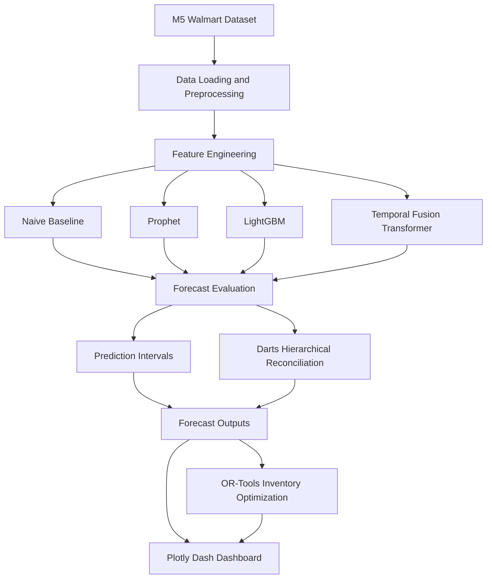

# Nationwide Demand Forecasting and Inventory Optimization

An end-to-end demand forecasting and inventory planning prototype using the M5 Walmart sales dataset. The project compares statistical and machine-learning forecasting approaches, reconciles forecasts across a product-store hierarchy, estimates demand uncertainty, and uses Google OR-Tools to generate inventory order recommendations.

**Repository:** https://github.com/swati-mishra07/nationwide-demand-inventory-optimization

## Project Overview

Retail demand varies across products, stores, dates, and seasonal events. This project explores how historical sales, calendar events, price information, and demand patterns can support better forecasting and inventory decisions.

The pipeline includes:

- M5 Walmart data loading and preprocessing
- Lag, rolling, calendar, event, SNAP, and price-related features
- Naive, Prophet, LightGBM, and Temporal Fusion Transformer (TFT) forecasting
- 28-day holdout evaluation
- Approximate prediction intervals
- Hierarchical forecast reconciliation using Darts
- Inventory order optimization using OR-Tools CP-SAT
- Interactive Plotly Dash dashboard

## Architecture



## Technology Stack

| Area | Tools |
|---|---|
| Language | Python |
| Data processing | Pandas, NumPy |
| Forecasting | Prophet, LightGBM, PyTorch Forecasting |
| Deep learning | PyTorch, PyTorch Lightning |
| Time-series hierarchy | Darts |
| Optimization | Google OR-Tools CP-SAT |
| Visualization | Plotly, Dash |
| Model persistence | Joblib, PyTorch checkpoints |

## Dataset and Scope

The project uses the [M5 Forecasting dataset](https://www.kaggle.com/competitions/m5-forecasting-accuracy/data), which contains Walmart historical sales, calendar information, and selling prices.

For this prototype, preprocessing selects:

- 100 items
- 2 stores: CA_1 and CA_2
- 1,941 daily observations per item-store series
- 200 item-store time series in total

The selected stores are both in California. Therefore, this is a limited-scope prototype of a nationwide forecasting architecture, not a full nationwide evaluation.

The M5 dataset does not contain an explicit promotion campaign flag. Price-related features are used as price signals and should not be interpreted as verified promotion labels.

## Forecasting Results

The models were evaluated on a 28-day holdout period.

| Model | WAPE | MAE | RMSE |
|---|---:|---:|---:|
| Naive baseline | 81.44% | 1.1623 | 1.9907 |
| Prophet | 82.65% | 1.1795 | 1.9808 |
| LightGBM | **75.32%** | 1.0750 | 1.7893 |
| TFT | 92.18% | 0.9350 | 1.5281 |

LightGBM achieved the lowest WAPE among these results and improved WAPE by approximately 6.12 percentage points compared with the naive baseline.

**Important evaluation note:** TFT was trained and evaluated on 20 item-store series, while the other models used 200. Its metrics are therefore not a directly comparable model ranking. RMSSE values are also based on implementation-specific calculations and should not be interpreted as official M5 competition scores.

The LightGBM holdout uses observed historical lag values during the test period for one-step-ahead predictions. It is not a fully recursive 28-day forecast.

## Hierarchical Forecast Reconciliation

Darts `BottomUpReconciliator` is used to aggregate item-store forecasts into store, state, and national levels.

Current sample hierarchy:

- 200 item-store series
- 2 stores
- 1 state
- 28 forecast dates

The reconciliation check passed, with a maximum aggregation difference of 0.0000000000 in the generated output.

Because the selected stores belong to California, the state and national totals in this prototype reflect only the selected sample.

## Inventory Optimization

The inventory module uses Google OR-Tools CP-SAT to calculate order recommendations under an illustrative cost and capacity setup.

The current run produced:

- Solver status: OPTIMAL
- Item-store combinations: 200
- Forecast demand: 7,745 units (approximately)
- Recommended order quantity: 9,184 units
- Expected shortage: 0 under the configured assumptions

These are prototype outputs, not validated operational recommendations. Opening inventory, supplier lead time, unit costs, holding costs, shortage penalties, and capacity are assumed because real business inputs were not available. Opening inventory is set to zero in the current run.

## Prediction Intervals

The project generates approximate uncertainty bands around LightGBM forecasts using historical item-store demand variability.

These are illustrative normal-variability bands, not statistically calibrated prediction intervals. They should not be treated as guaranteed coverage intervals.

## Interactive Dashboard

The Plotly Dash application provides:

- Forecast model metric comparisons
- Model, store, and item selection
- Actual-versus-predicted demand charts
- LightGBM uncertainty bands
- Inventory order recommendations
- Darts hierarchy and coherence information
- Dataset scope and assumption notes

## Project Structure

```text
nationwide-demand-inventory-optimization/
├── app/
│   └── dashboard.py
├── data/
│   ├── raw/
│   └── processed/
├── docs/
├── models/
├── reports/
│   ├── inventory/
│   ├── metrics/
│   ├── predictions/
│   └── reconciliation/
├── src/
│   ├── data/
│   │   ├── load_data.py
│   │   └── preprocess.py
│   ├── features/
│   │   └── build_features.py
│   ├── forecasting/
│   │   ├── naive.py
│   │   ├── prophet_model.py
│   │   ├── lightgbm_model.py
│   │   ├── tft_model.py
│   │   ├── uncertainty.py
│   │   ├── reconcile.py
│   │   └── darts_reconcile.py
│   └── inventory/
│       └── optimize_orders.py
├── .gitignore
└── README.md
```

## Setup

1. Clone the repository:

```bash
git clone https://github.com/swati-mishra07/nationwide-demand-inventory-optimization.git
cd nationwide-demand-inventory-optimization
```

2. Create and activate a virtual environment:

```powershell
py -3.11 -m venv .venv
.\.venv\Scripts\Activate.ps1
```

3. Install the project dependencies. Use the dependency list provided with the repository, if available.

4. Download the M5 Forecasting dataset from Kaggle and place the required CSV files in:

```text
data/raw/m5/
```

The raw dataset is excluded from Git because of its size.

## Run the Pipeline

Run these commands from the repository root with the virtual environment activated:

```powershell
python -m src.data.load_data
python -m src.data.preprocess
python -m src.features.build_features

python -m src.forecasting.naive
python -m src.forecasting.prophet_model
python -m src.forecasting.lightgbm_model
python -m src.forecasting.tft_model

python -m src.forecasting.uncertainty
python -m src.forecasting.reconcile
python -m src.forecasting.darts_reconcile

python -m src.inventory.optimize_orders
```

Launch the dashboard:

```powershell
python -m app.dashboard
```

Open the local address printed in the terminal, normally `http://127.0.0.1:8050/`.

Some outputs depend on the preceding pipeline stages being run first. The TFT training step can take longer, particularly on CPU.

## Generated Outputs

The pipeline generates reports under `reports/`, including:

- Forecast predictions and model metrics
- Model comparison results
- Prediction intervals
- Inventory recommendations and optimization summary
- Item-store, store, state, and Darts-reconciled forecasts

Model checkpoints and raw/processed datasets are not included in the Git repository by default.

## Limitations and Future Improvements

- Expand evaluation to all M5 stores, states, and items.
- Add explicit promotion data from an appropriate external source.
- Use real inventory-on-hand, supplier lead-time, cost, and capacity data.
- Calibrate prediction intervals using residual-based methods.
- Evaluate recursive multi-step forecasting.
- Add rolling-origin backtesting and official hierarchical metrics.
- Add automated tests, dependency pinning, and continuous integration.
- Explore more advanced reconciliation and inventory constraints.

## Project Demo

Watch the recorded end-to-end project demonstration:

[**Watch Demand Forecasting & Inventory Intelligence Demo**](https://drive.google.com/file/d/18bAg150uwp9Z8Wg5L5_ShWg256MyDFg4/view?usp=sharing)

The demonstration covers:
- Forecasting model comparison
- Interactive demand forecast dashboard
- Inventory optimization using OR-Tools
- Hierarchical forecast reconciliation using Darts

## Final Presentation

The 10-minute internship presentation is available here:

[Download the Final Presentation](presentation/Demand_Forecasting_Inventory_Intelligence.pptx)

## Author

Developed as a demand forecasting and inventory optimization project using retail time-series data, machine learning, hierarchical forecasting, and operations research.